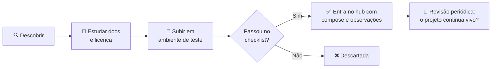

<div align="center">

# 🧩 Open Source Hub

### O concentrador central da minha curadoria de open source — ferramentas testadas, documentadas e prontas para produção

Um índice vivo das melhores soluções livres para **qualquer área da TI**: mídia, rede, DevOps, produtividade, IA e o que mais aparecer pela frente


</div>

---

> [!IMPORTANT]
> ## 🎯 A proposta deste hub
> Este repositório é o **ponto de partida para qualquer projeto futuro**: um concentrador de curadoria de open sources para diversas aplicações e soluções de TI. Aqui não existe lista genérica de 500 links — cada ferramenta registrada foi **instalada, configurada e validada em ambiente real**, e entra no índice com licença, porta padrão, `docker-compose` mínimo e observações práticas do dia a dia.
>
> Quando eu (ou você) precisar de uma solução open source, a resposta começa por aqui. 🔍

---

## 🧭 Navegação rápida

| Eu quero… | Vá para |
|---|---|
| Entender a proposta e o funcionamento do hub | [🎯 Sobre o hub](#-sobre-o-hub) |
| Ver o guia mais recente | [🌟 Guia em destaque](#-guia-em-destaque) |
| Entender como as ferramentas são escolhidas | [✅ Critério de curadoria](#-critério-de-curadoria) |
| Ver as ferramentas já curadas | [📚 Índice de categorias](#-índice-de-categorias) |
| Descobrir qual ferramenta serve para meu caso | [🧪 Qual escolher?](#-qual-escolher) |
| Ver o que vem por aí | [🚦 Roadmap de categorias](#-roadmap-de-categorias) |
| Entender o fluxo para adicionar ferramentas | [🤝 Como uma ferramenta entra no hub](#-como-uma-ferramenta-entra-no-hub) |
| Copiar o padrão de uma nova entrada | [📋 Template de entrada](#-template-de-entrada) |

---

## 🎯 Sobre o hub

**Este hub é um acervo pessoal de curadoria com ambição de utilidade pública.** A ideia nasceu de um problema real: toda vez que surge uma necessidade — montar um servidor de mídia, criar uma VPN, monitorar um serviço, substituir um software caro por algo livre — a mesma pergunta volta: *"qual ferramenta eu já testei e aprovo para isso?"*. Responder isso procurando em favoritos, anotações e históricos de navegador é improdutivo. A resposta certa é um índice centralizado, versionado no Git e aberto a quem quiser consultar.

**O princípio que rege o repositório é simples: qualidade acima de quantidade.** O hub pode conviver com categorias vazias, mas nunca com ferramentas que não passaram pelo checklist. Cada categoria representa uma área da TI onde soluções livres substituem (com vantagem) software proprietário — e o README foi desenhado para crescer sem perder a organização: novas ferramentas entram como linhas nas tabelas, novas categorias como novas seções, sempre no mesmo padrão.



### O que diferencia este hub de uma lista genérica?

| | 🧩 Este hub | 📋 Awesome lists genéricas |
|---|---|---|
| **Curadoria** | Manual, uma por vez | Volume alto, sem teste |
| **Status** | ✅ Só entra o testado | ⚠️ Misto (testados e "ouvi falar bem") |
| **Compose mínimo** | Sim, para cada ferramenta | Nem sempre |
| **Observações práticas** | Sim, do uso real | Raras |
| **Guias detalhados** | Por ferramenta, em `guias/` | Raros |

---

## 🌟 Guia em destaque

O guia mais completo publicado no hub até agora:

> [!IMPORTANT]
> ## 🎬 Jellyfin
> **Seu servidor de mídia próprio — livre, sem assinatura, sem telemetria.** Instalação nativa e Docker, aceleração por hardware, acesso remoto (VPN e reverse proxy), backup seguro e troubleshooting — tudo validado em ambiente real.
>
> 👉 **[Acesse o guia completo do Jellyfin](guias/jellyfin.md)**

<!-- Ajuste o link acima se o guia do Jellyfin estiver em outro repositório. -->

---

## ✅ Critério de curadoria

Só entra no hub uma ferramenta que atenda **todos** os critérios abaixo. Não é rigor por rigor: é o que garante que qualquer entrada aqui possa ser confiada de olhos fechados em um projeto real, seja um homelab familiar ou um ambiente corporativo.

| Critério | O que eu avalio |
|---|---|
| 🆓 **Licença livre** | GPL, AGPL, MIT, Apache… sem pegadinhas de open core ou licença dual restritiva |
| 🐳 **Imagem Docker oficial** | Bem mantida, com documentação de variáveis, volumes e portas |
| 📖 **Documentação digna** | Instalação, configuração e backup documentados de forma clara |
| ⚙️ **Roda em hardware modesto** | Funciona bem em Linux (Debian/Ubuntu) com recursos de homelab |
| 🔄 **Projeto vivo** | Releases frequentes, issues respondidas, comunidade ativa |
| 💾 **Caminho de backup claro** | Sei exatamente o que copiar para restaurar do zero |
| 🔒 **Privacidade** | Sem telemetria obrigatória, sem conta na nuvem do fornecedor |

### Legenda de status

| Ícone | Significado |
|---|---|
| ✅ **Testado** | Instalado, configurado e validado em ambiente real — pode ir para produção |
| 🔍 **Em avaliação** | Subiu no ambiente de teste, ainda em análise (não aparece no índice) |
| 📋 **Na fila** | Candidata registrada no roadmap, ainda não testada (só aparece no roadmap) |

---

## 📚 Índice de categorias

O hub é organizado por **área de aplicação**. Categorias curadas têm seção própria com tabelas e composes; as que ainda estão no papel apontam para o roadmap e ganham seção assim que a primeira ferramenta for aprovada.

| Categoria | Ferramentas | Status |
|---|:---:|---|
| [🎬 Mídia & Fotos](#-mídia--fotos) | 5 | ✅ Curada |
| [🌐 Rede & VPN](#-roadmap-de-categorias) | 0 | 📋 Em breve |
| [🚀 DevOps & Monitoramento](#-roadmap-de-categorias) | 0 | 📋 Em breve |
| [🤖 Produtividade & IA](#-roadmap-de-categorias) | 0 | 📋 Em breve |
| [💾 Armazenamento & Backup](#-roadmap-de-categorias) | 0 | 📋 Em breve |
| [🔐 Segurança & Senhas](#-roadmap-de-categorias) | 0 | 📋 Em breve |

---

## 🎬 Mídia & Fotos

Ferramentas para **servir, organizar e proteger** a biblioteca de mídia pessoal — filmes, séries, música, audiolivros e fotos — em um servidor próprio, sem assinatura e sem nuvem de terceiros. Todas as entradas abaixo foram testadas em ambiente real com Docker.

### 🎥 Servidores de mídia

| Status | Ferramenta | O que faz | Licença | Porta | Docs |
|:---:|---|---|:---:|:---:|:---:|
| ✅ | [**Jellyfin**](https://github.com/jellyfin/jellyfin) | Servidor de mídia completo: filmes, séries e música, com transcodificação por hardware e apps para todas as plataformas | `GPL-2.0` | 8096 | [📖](https://jellyfin.org/docs/) |
| ✅ | [**Navidrome**](https://github.com/navidrome/navidrome) | Streaming de música leve e rápido, compatível com apps Subsonic — perfeito para bibliotecas grandes | `GPL-3.0` | 4533 | [📖](https://www.navidrome.org/docs/) |
| ✅ | [**Audiobookshelf**](https://github.com/advplyr/audiobookshelf) | Servidor de audiolivros e podcasts, com progresso por capítulo e apps para celular | `GPL-3.0` | 13378 | [📖](https://www.audiobookshelf.org/) |

### 📷 Fotos & memórias

| Status | Ferramenta | O que faz | Licença | Porta | Docs |
|:---:|---|---|:---:|:---:|:---:|
| ✅ | [**Immich**](https://github.com/immich-app/immich) | A alternativa livre ao Google Fotos: backup automático do celular, busca por IA, rostos e memórias | `AGPL-3.0` | 2283 | [📖](https://immich.app/docs) |
| ✅ | [**PhotoPrism**](https://github.com/photoprism/photoprism) | Galeria de fotos com classificação automática por IA — leve, madura e fácil de manter | `AGPL-3.0` | 2342 | [📖](https://docs.photoprism.app/) |

### Compose mínimo de cada ferramenta

<details>
<summary><b>🎧 Navidrome — streaming de música</b></summary>

```yaml
services:
  navidrome:
    image: deluan/navidrome:latest       # Em produção, fixe a versão
    container_name: navidrome
    user: "1000:1000"
    ports:
      - "4533:4533"
    volumes:
      - /opt/navidrome/data:/data        # Banco e configurações ⚠️ BACKUP
      - /caminho/da/musica:/music:ro     # Biblioteca (somente leitura)
    restart: unless-stopped
```

> [!TIP]
> No celular, use apps compatíveis com **Subsonic** (Symfonium, DSub, Substreamer) apontando para `http://<IP>:4533`.

</details>

<details>
<summary><b>📚 Audiobookshelf — audiolivros e podcasts</b></summary>

```yaml
services:
  audiobookshelf:
    image: ghcr.io/advplyr/audiobookshelf:latest
    container_name: audiobookshelf
    ports:
      - "13378:80"
    volumes:
      - /opt/audiobookshelf/config:/config     # Configurações ⚠️ BACKUP
      - /opt/audiobookshelf/metadata:/metadata # Metadados e capas ⚠️ BACKUP
      - /caminho/dos/audiolivros:/audiobooks
      - /caminho/dos/podcasts:/podcasts
    restart: unless-stopped
```

> [!NOTE]
> O progresso de reprodução fica em `/config` e os metadados em `/metadata` — esses dois diretórios são o backup obrigatório.

</details>

<details>
<summary><b>📸 Immich — backup de fotos do celular</b></summary>

O Immich é uma **stack com múltiplos serviços** (servidor, machine learning, banco de dados e cache). Use o compose oficial, sempre atualizado:

```bash
mkdir -p /opt/immich && cd /opt/immich
wget -O docker-compose.yml https://github.com/immich-app/immich/releases/latest/download/docker-compose.yml
wget -O .env https://github.com/immich-app/immich/releases/latest/download/example.env
# Edite o .env antes de subir: UPLOAD_LOCATION, DB_PASSWORD e TZ
docker compose up -d
```

> [!IMPORTANT]
> Defina `UPLOAD_LOCATION` (onde as fotos ficam), `DB_PASSWORD` e `TZ` no `.env` **antes** do primeiro `up`. O acesso inicial é em `http://<IP>:2283`. O backup obrigatório inclui a pasta de upload **e** o volume do banco.

</details>

<details>
<summary><b>🖼️ PhotoPrism — galeria com IA</b></summary>

```yaml
services:
  photoprism:
    image: photoprism/photoprism:latest
    container_name: photoprism
    environment:
      PHOTOPRISM_ADMIN_PASSWORD: "troque-esta-senha"
      PHOTOPRISM_SITE_URL: "http://localhost:2342"
    ports:
      - "2342:2342"
    volumes:
      - /caminho/das/fotos:/photoprism/originals
      - /opt/photoprism/storage:/photoprism/storage   # Banco e índice ⚠️ BACKUP
    restart: unless-stopped
```

> [!CAUTION]
> Para bibliotecas grandes (mais de 100 mil arquivos), use o compose oficial com **MariaDB** — o SQLite embutido não dá conta do volume.

</details>

> [!NOTE]
> **E o Jellyfin?** O compose completo, aceleração por GPU, acesso remoto e troubleshooting estão no [guia em destaque](#-guia-em-destaque) — não vou duplicar aqui o que já tem guia dedicado.

### 🧪 Qual escolher?


| Se você quer… | Escolha | Por quê |
|---|---|---|
| Substituir Netflix + YouTube da família | 🎬 Jellyfin | Recursos mais completos e apps maduros |
| Ouvir a própria coleção de música | 🎧 Navidrome | Muito leve e apps Subsonic excelentes |
| Audiolivros e podcasts com progresso | 📚 Audiobookshelf | Feito exatamente para isso |
| Substituir o Google Fotos | 📸 Immich | Backup automático + busca por IA |
| Uma galeria simples e leve | 🖼️ PhotoPrism | Menor consumo de recursos |

---

## 🚦 Roadmap de categorias

Categorias já mapeadas e aguardando curadoria. **Nenhuma ferramenta entra no índice sem passar no checklist** — quando uma categoria ganhar entradas testadas, ela recebe sua seção completa e o índice é atualizado.

| Categoria | Candidatas na fila | Status |
|---|---|:---:|
| 🌐 Rede & VPN | Tailscale, WireGuard, Pi-hole, AdGuard Home, Nginx Proxy Manager | 📋 Em breve |
| 🚀 DevOps & Monitoramento | Portainer, Gitea, Grafana, Prometheus, Uptime Kuma, Dockge | 📋 Em breve |
| 🤖 Produtividade & IA | Nextcloud, Paperless-ngx, n8n, Ollama + Open WebUI | 📋 Em breve |
| 💾 Armazenamento & Backup | MinIO, Syncthing, Restic, Duplicati, BorgBackup | 📋 Em breve |
| 🔐 Segurança & Senhas | Vaultwarden, Authentik, 2FAuth | 📋 Em breve |

> [!TIP]
> Tem uma sugestão de ferramenta para qualquer uma dessas categorias? Abra uma **issue** com o link do projeto — ela entra na fila de curadoria.

---

## 🤝 Como uma ferramenta entra no hub

O fluxo é o mesmo para qualquer categoria — mídia hoje, banco de dados ou automação amanhã:

1. **🔍 Descoberta** — identifique a ferramenta e a necessidade que ela atende
2. **📖 Estudo** — leia a documentação, confirme a licença e o estado do projeto
3. **🐳 Teste** — suba em ambiente isolado com Docker e use de verdade
4. **✅ Validação** — passe por todos os critérios do [checklist](#-critério-de-curadoria)
5. **📝 Registro** — adicione a linha na tabela da categoria e o compose mínimo em `<details>`
6. **⭐ Aprofundamento (opcional)** — crie um guia completo em `guias/<ferramenta>.md` e destaque-o no topo do hub

### 📋 Template de entrada

Copie o bloco abaixo para adicionar uma ferramenta a qualquer categoria — assim o índice mantém o mesmo padrão para sempre:

`````markdown
| ✅ | [**Nome**](https://github.com/usuario/repo) | Descrição em uma linha do que a ferramenta faz | `Licença` | 0000 | [📖](https://docs-url) |

<details>
<summary><b>🔧 Nome — compose mínimo</b></summary>

```yaml
services:
  nome:
    image: usuario/imagem:latest
    container_name: nome
    ports:
      - "0000:0000"
    volumes:
      - /opt/nome/data:/data    # ⚠️ BACKUP
    restart: unless-stopped
```

> [!TIP]
> Observação prática do uso real.
</details>
`````

---

## 📁 Estrutura do repositório

O layout cresce junto com o acervo — índice central no README e uma pasta de guias por ferramenta:

```text
opensource-hub/
├── README.md                  # 👈 você está aqui: índice central da curadoria
├── guias/                     # guias detalhados (um arquivo por ferramenta)
│   └── jellyfin.md
└── assets/                    # imagens, diagramas e screenshots
```

---

## 🔗 Referências

| Tema | Link |
|---|---|
| Diretório de apps self-hosted | [awesome-selfhosted](https://github.com/awesome-selfhosted/awesome-selfhosted) |
| Catálogo e estatísticas de apps self-hosted | [selfh.st](https://selfh.st/) |
| Alternativas livres a software proprietário | [AlternativeTo](https://alternativeto.net/) |
| Como escolher licenças open source | [Choose a License](https://choosealicense.com/) |
| Imagens Docker confiáveis para homelab | [LinuxServer.io](https://www.linuxserver.io/) |

---

<div align="center">

### 👤 Autor

**Eduardo Pena Grigorio** · DevOps · Salvador, BA

*Hub criado para centralizar a curadoria de soluções open source, para reutilização em projetos futuros.*

⭐ Se este hub foi útil para você, deixe uma estrela no repositório!

</div>
