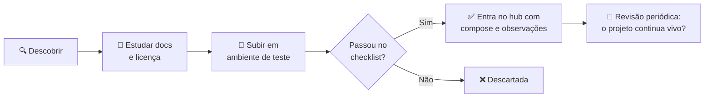
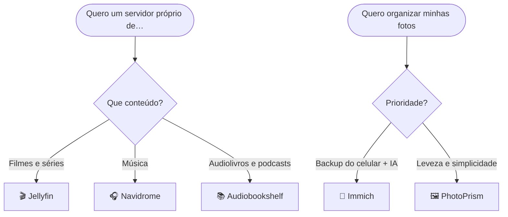

<div align="center">

# 🧩 Open Source Hub

### O concentrador central da minha curadoria de open source — ferramentas testadas, documentadas e prontas para produção

Um índice vivo das melhores soluções livres para **qualquer área da TI**: mídia, rede, DevOps, produtividade, IA e o que mais aparecer pela frente


</div>

---

> [!IMPORTANT]
> ## 🎯 A proposta deste hub
> Este repositório é o **ponto de partida para qualquer projeto futuro**: um concentrador de curadoria de open sources para diversas aplicações e soluções de TI. Aqui não existe lista genérica de 500 links — cada ferramenta registrada foi **instalada, configurada e validada em ambiente real**, e entra no índice com licença, porta padrão, `docker-compose` mínimo e observações práticas do dia a dia.
>
> Quando eu (ou você) precisar de uma solução open source, a resposta começa por aqui. 🔍

---

## 🧭 Navegação rápida

| Eu quero… | Vá para |
|---|---|
| Entender a proposta e o funcionamento do hub | [🎯 Sobre o hub](#-sobre-o-hub) |
| Ver o guia mais recente | [🌟 Guia em destaque](#-guia-em-destaque) |
| Entender como as ferramentas são escolhidas | [✅ Critério de curadoria](#-critério-de-curadoria) |
| Ver as ferramentas já curadas | [📚 Índice de categorias](#-índice-de-categorias) |
| Ver ferramentas de **infraestrutura** (monitoramento, ITSM, acesso remoto) | [📡 Monitoramento & Gestão de TI](#-monitoramento--gestão-de-ti) |
| Ver alternativas livres ao **pacote Office** | [📝 Produtividade & Escritório](#-produtividade--escritório) |
| Ver alternativas livres ao **pacote Adobe** | [🎨 Design & Criação](#-design--criação) |
| Descobrir qual ferramenta serve para meu caso | [🧪 Qual escolher?](#-qual-escolher) |
| Ver o que vem por aí | [🚦 Roadmap de categorias](#-roadmap-de-categorias) |
| Entender o fluxo para adicionar ferramentas | [🤝 Como uma ferramenta entra no hub](#-como-uma-ferramenta-entra-no-hub) |
| Copiar o padrão de uma nova entrada | [📋 Template de entrada](#-template-de-entrada) |

---

## 🎯 Sobre o hub

**Este hub é um acervo pessoal de curadoria com ambição de utilidade pública.** A ideia nasceu de um problema real: toda vez que surge uma necessidade — montar um servidor de mídia, criar uma VPN, monitorar um serviço, substituir um software caro por algo livre — a mesma pergunta volta: *"qual ferramenta eu já testei e aprovo para isso?"*. Responder isso procurando em favoritos, anotações e históricos de navegador é improdutivo. A resposta certa é um índice centralizado, versionado no Git e aberto a quem quiser consultar.

**O princípio que rege o repositório é simples: qualidade acima de quantidade.** O hub pode conviver com categorias vazias, mas nunca com ferramentas que não passaram pelo checklist. Cada categoria representa uma área da TI onde soluções livres substituem (com vantagem) software proprietário — e o README foi desenhado para crescer sem perder a organização: novas ferramentas entram como linhas nas tabelas, novas categorias como novas seções, sempre no mesmo padrão.



### O que diferencia este hub de uma lista genérica?

| | 🧩 Este hub | 📋 Awesome lists genéricas |
|---|---|---|
| **Curadoria** | Manual, uma por vez | Volume alto, sem teste |
| **Status** | ✅ Só entra o testado | ⚠️ Misto (testados e "ouvi falar bem") |
| **Compose mínimo** | Sim, para cada ferramenta de servidor | Nem sempre |
| **Observações práticas** | Sim, do uso real | Raras |
| **Guias detalhados** | Por ferramenta, em `guias/` | Raros |

---

## 🌟 Guia em destaque

O guia mais completo publicado no hub até agora:

> [!IMPORTANT]
> ## 🎬 Jellyfin
> **Seu servidor de mídia próprio — livre, sem assinatura, sem telemetria.** Instalação nativa e Docker, aceleração por hardware, acesso remoto (VPN e reverse proxy), backup seguro e troubleshooting — tudo validado em ambiente real.
>
> 👉 **[Acesse o guia completo do Jellyfin](guias/jellyfin.md)**

<!-- Ajuste o link acima se o guia do Jellyfin estiver em outro repositório. -->

---

## ✅ Critério de curadoria

Só entra no hub uma ferramenta que atenda **todos** os critérios abaixo. Não é rigor por rigor: é o que garante que qualquer entrada aqui possa ser confiada de olhos fechados em um projeto real, seja um homelab familiar ou um ambiente corporativo.

| Critério | O que eu avalio |
|---|---|
| 🆓 **Licença livre** | GPL, AGPL, MIT, Apache… sem pegadinhas de open core ou licença dual restritiva |
| 🐳 **Imagem Docker oficial** | Bem mantida, com documentação de variáveis, volumes e portas |
| 📖 **Documentação digna** | Instalação, configuração e backup documentados de forma clara |
| ⚙️ **Roda em hardware modesto** | Funciona bem em Linux (Debian/Ubuntu) com recursos de homelab |
| 🔄 **Projeto vivo** | Releases frequentes, issues respondidas, comunidade ativa |
| 💾 **Caminho de backup claro** | Sei exatamente o que copiar para restaurar do zero |
| 🔒 **Privacidade** | Sem telemetria obrigatória, sem conta na nuvem do fornecedor |

### Legenda de status

| Ícone | Significado |
|---|---|
| ✅ **Testado** | Instalado, configurado e validado em ambiente real — pode ir para produção |
| 🔍 **Em avaliação** | Subiu no ambiente de teste, ainda em análise (não aparece no índice) |
| 📋 **Na fila** | Candidata registrada no roadmap, ainda não testada (só aparece no roadmap) |

---

## 📚 Índice de categorias

O hub cobre **tudo que um ambiente de TI de verdade precisa** — da rede que conecta ao ERP que fatura — organizado em 4 grandes domínios. Categorias curadas têm seção própria com tabelas e composes; as demais estão mapeadas no [roadmap](#-roadmap-de-categorias) com candidatas na fila e ganham seção assim que a primeira ferramenta for aprovada.

| Categoria | Ferramentas | Status |
|---|:---:|---|
| **🧱 Infraestrutura & Operações** | | |
| [🎬 Mídia & Fotos](#-mídia--fotos) | 5 | ✅ Curada |
| [📡 Monitoramento & Gestão de TI](#-monitoramento--gestão-de-ti) | 4 | ✅ Curada |
| [🌐 Rede & VPN](#-roadmap-de-categorias) | 0 | 📋 Em breve |
| [🖥️ Virtualização & Containers](#-roadmap-de-categorias) | 0 | 📋 Em breve |
| [💾 Armazenamento & Backup](#-roadmap-de-categorias) | 0 | 📋 Em breve |
| [🗄️ Bancos de Dados](#-roadmap-de-categorias) | 0 | 📋 Em breve |
| **⚙️ Desenvolvimento & Operações** | | |
| [🚀 DevOps & CI/CD](#-roadmap-de-categorias) | 0 | 📋 Em breve |
| [📊 Observabilidade & Logs](#-roadmap-de-categorias) | 0 | 📋 Em breve |
| **💼 Colaboração & Negócio** | | |
| [📝 Produtividade & Escritório](#-produtividade--escritório) | 3 | ✅ Curada |
| [🎨 Design & Criação](#-design--criação) | 5 | ✅ Curada |
| [🤝 Comunicação & Colaboração](#-roadmap-de-categorias) | 0 | 📋 Em breve |
| [📄 Documentos & Conhecimento](#-roadmap-de-categorias) | 0 | 📋 Em breve |
| [📋 Projetos & Gestão](#-roadmap-de-categorias) | 0 | 📋 Em breve |
| [🏢 ERP & CRM](#-roadmap-de-categorias) | 0 | 📋 Em breve |
| [🌍 Web & E-commerce](#-roadmap-de-categorias) | 0 | 📋 Em breve |
| **🧠 Dados, IA & Segurança** | | |
| [🤖 IA & Automação](#-roadmap-de-categorias) | 0 | 📋 Em breve |
| [📈 Dados & BI](#-roadmap-de-categorias) | 0 | 📋 Em breve |
| [🔐 Segurança & Identidade](#-roadmap-de-categorias) | 0 | 📋 Em breve |
| [🏠 IoT & Domótica](#-roadmap-de-categorias) | 0 | 📋 Em breve |

---

## 🎬 Mídia & Fotos

Ferramentas para **servir, organizar e proteger** a biblioteca de mídia pessoal — filmes, séries, música, audiolivros e fotos — em um servidor próprio, sem assinatura e sem nuvem de terceiros. Todas as entradas abaixo foram testadas em ambiente real com Docker.

### 🎥 Servidores de mídia

| Status | Ferramenta | O que faz | Licença | Porta | Docs |
|:---:|---|---|:---:|:---:|:---:|
| ✅ | [**Jellyfin**](https://github.com/jellyfin/jellyfin) | Servidor de mídia completo: filmes, séries e música, com transcodificação por hardware e apps para todas as plataformas | `GPL-2.0` | 8096 | [📖](https://jellyfin.org/docs/) |
| ✅ | [**Navidrome**](https://github.com/navidrome/navidrome) | Streaming de música leve e rápido, compatível com apps Subsonic — perfeito para bibliotecas grandes | `GPL-3.0` | 4533 | [📖](https://www.navidrome.org/docs/) |
| ✅ | [**Audiobookshelf**](https://github.com/advplyr/audiobookshelf) | Servidor de audiolivros e podcasts, com progresso por capítulo e apps para celular | `GPL-3.0` | 13378 | [📖](https://www.audiobookshelf.org/) |

### 📷 Fotos & memórias

| Status | Ferramenta | O que faz | Licença | Porta | Docs |
|:---:|---|---|:---:|:---:|:---:|
| ✅ | [**Immich**](https://github.com/immich-app/immich) | A alternativa livre ao Google Fotos: backup automático do celular, busca por IA, rostos e memórias | `AGPL-3.0` | 2283 | [📖](https://immich.app/docs) |
| ✅ | [**PhotoPrism**](https://github.com/photoprism/photoprism) | Galeria de fotos com classificação automática por IA — leve, madura e fácil de manter | `AGPL-3.0` | 2342 | [📖](https://docs.photoprism.app/) |

### Compose mínimo de cada ferramenta

<details>
<summary><b>🎧 Navidrome — streaming de música</b></summary>

```yaml
services:
  navidrome:
    image: deluan/navidrome:latest       # Em produção, fixe a versão
    container_name: navidrome
    user: "1000:1000"
    ports:
      - "4533:4533"
    volumes:
      - /opt/navidrome/data:/data        # Banco e configurações ⚠️ BACKUP
      - /caminho/da/musica:/music:ro     # Biblioteca (somente leitura)
    restart: unless-stopped
```

> [!TIP]
> No celular, use apps compatíveis com **Subsonic** (Symfonium, DSub, Substreamer) apontando para `http://<IP>:4533`.

</details>

<details>
<summary><b>📚 Audiobookshelf — audiolivros e podcasts</b></summary>

```yaml
services:
  audiobookshelf:
    image: ghcr.io/advplyr/audiobookshelf:latest
    container_name: audiobookshelf
    ports:
      - "13378:80"
    volumes:
      - /opt/audiobookshelf/config:/config     # Configurações ⚠️ BACKUP
      - /opt/audiobookshelf/metadata:/metadata # Metadados e capas ⚠️ BACKUP
      - /caminho/dos/audiolivros:/audiobooks
      - /caminho/dos/podcasts:/podcasts
    restart: unless-stopped
```

> [!NOTE]
> O progresso de reprodução fica em `/config` e os metadados em `/metadata` — esses dois diretórios são o backup obrigatório.

</details>

<details>
<summary><b>📸 Immich — backup de fotos do celular</b></summary>

O Immich é uma **stack com múltiplos serviços** (servidor, machine learning, banco de dados e cache). Use o compose oficial, sempre atualizado:

```bash
mkdir -p /opt/immich && cd /opt/immich
wget -O docker-compose.yml https://github.com/immich-app/immich/releases/latest/download/docker-compose.yml
wget -O .env https://github.com/immich-app/immich/releases/latest/download/example.env
# Edite o .env antes de subir: UPLOAD_LOCATION, DB_PASSWORD e TZ
docker compose up -d
```

> [!IMPORTANT]
> Defina `UPLOAD_LOCATION` (onde as fotos ficam), `DB_PASSWORD` e `TZ` no `.env` **antes** do primeiro `up`. O acesso inicial é em `http://<IP>:2283`. O backup obrigatório inclui a pasta de upload **e** o volume do banco.

</details>

<details>
<summary><b>🖼️ PhotoPrism — galeria com IA</b></summary>

```yaml
services:
  photoprism:
    image: photoprism/photoprism:latest
    container_name: photoprism
    environment:
      PHOTOPRISM_ADMIN_PASSWORD: "troque-esta-senha"
      PHOTOPRISM_SITE_URL: "http://localhost:2342"
    ports:
      - "2342:2342"
    volumes:
      - /caminho/das/fotos:/photoprism/originals
      - /opt/photoprism/storage:/photoprism/storage   # Banco e índice ⚠️ BACKUP
    restart: unless-stopped
```

> [!CAUTION]
> Para bibliotecas grandes (mais de 100 mil arquivos), use o compose oficial com **MariaDB** — o SQLite embutido não dá conta do volume.

</details>

> [!NOTE]
> **E o Jellyfin?** O compose completo, aceleração por GPU, acesso remoto e troubleshooting estão no [guia em destaque](#-guia-em-destaque) — não vou duplicar aqui o que já tem guia dedicado.

### 🧪 Qual escolher?



| Se você quer… | Escolha | Por quê |
|---|---|---|
| Substituir Netflix + YouTube da família | 🎬 Jellyfin | Recursos mais completos e apps maduros |
| Ouvir a própria coleção de música | 🎧 Navidrome | Muito leve e apps Subsonic excelentes |
| Audiolivros e podcasts com progresso | 📚 Audiobookshelf | Feito exatamente para isso |
| Substituir o Google Fotos | 📸 Immich | Backup automático + busca por IA |
| Uma galeria simples e leve | 🖼️ PhotoPrism | Menor consumo de recursos |

---

## 📡 Monitoramento & Gestão de TI

Aqui ficam as ferramentas para **operar a TI como um todo**: acompanhar a saúde de servidores e redes, organizar ativos e chamados e acessar máquinas remotamente com segurança. É a categoria que mais cresce quando o homelab deixa de ser brincadeira — e é peça-chave em ambientes corporativos. Todas as entradas rodam em Docker e estão validadas em ambiente real.

### 📈 Monitoramento

| Status | Ferramenta | O que faz | Licença | Porta | Docs |
|:---:|---|---|:---:|:---:|:---:|
| ✅ | [**Zabbix**](https://github.com/zabbix/zabbix) | Monitoramento completo de rede, servidores e serviços: coleta, alertas, dashboards e templates prontos para tudo | `GPL-2.0` | 80 | [📖](https://www.zabbix.com/documentation/current/) |
| ✅ | [**Grafana**](https://github.com/grafana/grafana) | Visualização e dashboards para qualquer fonte de dados — o complemento perfeito do Zabbix e do Prometheus | `AGPL-3.0` | 3000 | [📖](https://grafana.com/docs/) |

### 🎫 Gestão de TI (ITSM)

| Status | Ferramenta | O que faz | Licença | Porta | Docs |
|:---:|---|---|:---:|:---:|:---:|
| ✅ | [**GLPI**](https://github.com/glpi-project/glpi) | Gestão de ativos e serviços de TI: inventário, helpdesk, licenças e auditoria de software | `GPL-3.0` | 80 | [📖](https://glpi-project.org/pt-br/documentacao/) |

### 🔌 Acesso remoto

| Status | Ferramenta | O que faz | Licença | Porta | Docs |
|:---:|---|---|:---:|:---:|:---:|
| ✅ | [**MeshCentral**](https://github.com/Ylianst/MeshCentral) | Gerenciamento e acesso remoto via web — alternativa livre a AnyDesk e TeamViewer | `Apache-2.0` | 443 | [📖](https://docs.meshcentral.com/) |

### Compose mínimo de cada ferramenta

<details>
<summary><b>📈 Zabbix — appliance all-in-one</b></summary>

```yaml
services:
  zabbix:
    image: zabbix/zabbix-appliance:latest   # Banco incluso — ideal para testes e laboratório
    container_name: zabbix
    ports:
      - "80:80"        # Interface web
      - "10051:10051"  # Servidor — agentes enviam dados para cá
    restart: unless-stopped
```

> [!TIP]
> Login padrão: **Admin** / **zabbix** — troque imediatamente. Para produção, prefira a stack completa do [zabbix-docker](https://github.com/zabbix/zabbix-docker) (servidor, frontend e banco separados).

</details>

<details>
<summary><b>📊 Grafana — dashboards</b></summary>

```yaml
services:
  grafana:
    image: grafana/grafana:latest           # Em produção, fixe a versão
    container_name: grafana
    user: "1000:1000"                       # chown 1000:1000 /opt/grafana
    ports:
      - "3000:3000"
    volumes:
      - /opt/grafana/data:/var/lib/grafana  # Dashboards e banco ⚠️ BACKUP
    restart: unless-stopped
```

> [!TIP]
> Login padrão: **admin** / **admin**. Habilite a integração oficial com o **Zabbix** (*Plugins → Data sources*) para criar dashboards sobre os dados coletados por ele.

</details>

<details>
<summary><b>🎫 GLPI — ITSM (com MariaDB)</b></summary>

```yaml
services:
  glpi:
    image: glpi/glpi:latest
    container_name: glpi
    ports:
      - "8080:80"
    environment:
      TIMEZONE: "America/Bahia"
    volumes:
      - /opt/glpi/files:/var/www/html/glpi/files   # Uploads e anexos ⚠️ BACKUP
      - /opt/glpi/config:/etc/glpi                 # Configurações ⚠️ BACKUP
    depends_on:
      - glpi-db
    restart: unless-stopped

  glpi-db:
    image: mariadb:latest
    container_name: glpi-db
    environment:
      MARIADB_ROOT_PASSWORD: "troque-esta-senha"
      MARIADB_DATABASE: glpi
      MARIADB_USER: glpi
      MARIADB_PASSWORD: "troque-esta-senha"
    volumes:
      - /opt/glpi/db:/var/lib/mysql                # Banco ⚠️ BACKUP
    restart: unless-stopped
```

> [!NOTE]
> O **GLPI Agent** é quem coleta o inventário das máquinas — instale-o nos endpoints e aponte para o servidor GLPI.

</details>

<details>
<summary><b>🖥️ MeshCentral — acesso remoto</b></summary>

```yaml
services:
  meshcentral:
    image: mymeshcentral/meshcentral:latest
    container_name: meshcentral
    ports:
      - "80:80"      # Redireciona para HTTPS
      - "443:443"    # Interface principal
      - "4430:4430"  # Administração
    environment:
      - NODE_ENV=production
    volumes:
      - /opt/meshcentral/data:/opt/meshcentral/meshcentral-data     # Config e banco ⚠️ BACKUP
      - /opt/meshcentral/files:/opt/meshcentral/meshcentral-files   # Arquivos transferidos
    restart: unless-stopped
```

> [!CAUTION]
> Exponha o MeshCentral sempre atrás de **HTTPS** e, se possível, de reverse proxy ou VPN — veja o fluxo de acesso remoto no [guia do Jellyfin](guias/jellyfin.md).

</details>

### 🧪 Como combinar?

| Se você quer… | Escolha | Por quê |
|---|---|---|
| Monitorar infraestrutura com alertas robustos | 📈 Zabbix | Coleta madura, templates prontos, alertas por qualquer canal |
| Visualizar métricas de qualquer fonte | 📊 Grafana | Dashboards flexíveis — usa Zabbix, Prometheus e mais como fonte |
| Inventário + helpdesk interno | 🎫 GLPI | ITIL completo: ativos, chamados, licenças e auditoria |
| Acessar máquinas remotamente | 🖥️ MeshCentral | Alternativa livre a AnyDesk/TeamViewer, self-hosted |

> [!TIP]
> **Zabbix e Grafana não competem — se complementam.** O Zabbix coleta e alerta; o Grafana transforma os dados em dashboards. A integração entre os dois é oficial e trivial.

---

## 📝 Produtividade & Escritório

Alternativas livres ao **pacote Office**, escritas em Rust puro como reimplementações *clean-room* (nada de código proprietário por baixo). Diferente das categorias anteriores, são **aplicativos nativos** — sem Docker, sem servidor, sem porta: instale e use. Rodam em Linux, macOS e Windows (e, em alguns casos, no navegador via WebAssembly).

| Status | Ferramenta | O que faz | Substitui | Licença |
|:---:|---|---|---|:---:|
| ✅ | [**WordCraft**](https://github.com/storytold/wordcraft) | Processador de texto moderno: estilos, tabelas, controle de alterações, referências e mala direta | Microsoft Word | `MIT / Apache-2.0` |
| ✅ | [**GridCraft**](https://github.com/storytold/gridcraft) | Planilhas de alta performance, nativas e no navegador | Microsoft Excel | `MIT / Apache-2.0` |
| ✅ | [**DeckCraft**](https://github.com/storytold/deckcraft) | Designer de apresentações: temas, formas, gráficos, transições e animações, com suporte a `.pptx` | Microsoft PowerPoint | `MIT / Apache-2.0` |

> [!TIP]
> Os três juntos formam um **pacote ofimático completo e livre** — e os formatos `.docx`, `.xlsx` e `.pptx` são suportados, o que facilita a migração de quem já tem documentos prontos.

---

## 🎨 Design & Criação

Alternativas livres ao **pacote Adobe**, do mesmo ecossistema (*Storytold*), também em Rust puro e **apps nativos** — sem Docker, sem servidor. A proposta é a mesma da categoria anterior: substituir software caro por ferramentas livres, sem abrir mão de recursos profissionais.

| Status | Ferramenta | O que faz | Substitui | Licença |
|:---:|---|---|---|:---:|
| ✅ | [**PhotoCraft**](https://github.com/storytold/photocraft) | Editor de fotos com camadas, máscaras, ajustes e suporte a PSD — compositor por GPU | Adobe Photoshop | `MIT / Apache-2.0` |
| ✅ | [**PdfCraft**](https://github.com/storytold/pdfcraft) | Leitor e editor de PDF: organizar, combinar, dividir e proteger documentos | Adobe Acrobat | `MIT / Apache-2.0` |
| ✅ | [**EffectCraft**](https://github.com/storytold/effectcraft) | Estúdio de motion graphics e efeitos visuais para títulos animados e VFX | Adobe After Effects | `MIT / Apache-2.0` |
| ✅ | [**FilmCraft**](https://github.com/storytold/filmcraft) | Editor de vídeo profissional não-linear, com correção de cor, efeitos e processamento de áudio | Adobe Premiere Pro | `MIT / Apache-2.0` |
| ⚠️ | [**ArtCraft-Services**](https://github.com/storytold/artcraft-services) | Backend do ecossistema ArtCraft: API HTTP, autenticação, uploads e fila de jobs — só é necessário para hospedar a plataforma completa | Infra do pacote | `Licença própria` |

> [!CAUTION]
> **Atenção ao ArtCraft-Services:** usa uma licença própria "fair source" — o código é visível, mas **não** é uma licença open source padrão (MIT, GPL, Apache). Fica no hub com essa ressalva: os aplicativos da suíte são 100% livres; o backend tem restrições próprias.

> [!NOTE]
> Os apps do pacote Design & Criação funcionam **de forma independente** — o ArtCraft-Services só entra em cena se você quiser hospedar a plataforma completa, com contas, créditos e jobs centralizados.

---

## 🚦 Roadmap de categorias

Um ambiente de TI completo precisa de ferramentas em **todas as frentes abaixo** — da rede que conecta os servidores ao ERP que fatura o negócio. São 15 categorias mapeadas em 4 domínios, todas com candidatas na fila. **Nenhuma ferramenta entra no índice sem passar no checklist** — quando uma categoria ganhar entradas testadas, ela recebe sua seção completa e o índice é atualizado.

| Categoria | Candidatas na fila | Status |
|---|---|:---:|
| **🧱 Infraestrutura & Operações** | | |
| 🌐 Rede & VPN | Tailscale, WireGuard, Pi-hole, AdGuard Home, OPNsense, Nginx Proxy Manager | 📋 Em breve |
| 🖥️ Virtualização & Containers | Proxmox VE, Portainer, Dockge, Incus, k3s | 📋 Em breve |
| 💾 Armazenamento & Backup | TrueNAS, MinIO, Syncthing, Restic, BorgBackup, UrBackup | 📋 Em breve |
| 🗄️ Bancos de Dados | PostgreSQL, MariaDB, MongoDB, Redis/Valkey, pgAdmin, Adminer | 📋 Em breve |
| 🚀 DevOps & CI/CD | Gitea, GitLab CE, Jenkins, Drone, Harbor, Ansible | 📋 Em breve |
| 📊 Observabilidade & Logs | Prometheus, Loki, Netdata, Uptime Kuma, Graylog | 📋 Em breve |
| **💼 Colaboração & Negócio** | | |
| 🤝 Comunicação & Colaboração | Nextcloud, Mattermost, Rocket.Chat, Jitsi Meet, Mailcow, Matrix (Synapse) | 📋 Em breve |
| 📄 Documentos & Conhecimento | BookStack, Wiki.js, Outline, Paperless-ngx, Trilium Notes | 📋 Em breve |
| 📋 Projetos & Gestão | OpenProject, Taiga, Redmine, Focalboard, Leantime | 📋 Em breve |
| 🏢 ERP & CRM | Odoo, ERPNext, Dolibarr, SuiteCRM, Frappe HR | 📋 Em breve |
| 🌍 Web & E-commerce | WordPress, Ghost, WooCommerce, PrestaShop, Medusa | 📋 Em breve |
| **🧠 Dados, IA & Segurança** | | |
| 🤖 IA & Automação | Ollama + Open WebUI, n8n, Node-RED, Langflow, Flowise | 📋 Em breve |
| 📈 Dados & BI | Metabase, Apache Superset, Apache Airflow, Redash | 📋 Em breve |
| 🔐 Segurança & Identidade | Vaultwarden, Keycloak, Authentik, CrowdSec, Fail2ban, 2FAuth | 📋 Em breve |
| 🏠 IoT & Domótica | Home Assistant, Mosquitto, Zigbee2MQTT, ESPHome | 📋 Em breve |

> [!TIP]
> Tem uma sugestão de ferramenta para qualquer uma dessas categorias? Abra uma **issue** com o link do projeto — ela entra na fila de curadoria.

---

## 🤝 Como uma ferramenta entra no hub

O fluxo é o mesmo para qualquer categoria — mídia hoje, banco de dados ou automação amanhã:

1. **🔍 Descoberta** — identifique a ferramenta e a necessidade que ela atende
2. **📖 Estudo** — leia a documentação, confirme a licença e o estado do projeto
3. **🐳 Teste** — suba em ambiente isolado com Docker e use de verdade
4. **✅ Validação** — passe por todos os critérios do [checklist](#-critério-de-curadoria)
5. **📝 Registro** — adicione a linha na tabela da categoria e o compose mínimo em `<details>`
6. **⭐ Aprofundamento (opcional)** — crie um guia completo em `guias/<ferramenta>.md` e destaque-o no topo do hub

### 📋 Template de entrada

Copie o bloco abaixo para adicionar uma ferramenta a qualquer categoria — assim o índice mantém o mesmo padrão para sempre:

`````markdown
| ✅ | [**Nome**](https://github.com/usuario/repo) | Descrição em uma linha do que a ferramenta faz | `Licença` | 0000 | [📖](https://docs-url) |

<details>
<summary><b>🔧 Nome — compose mínimo</b></summary>

```yaml
services:
  nome:
    image: usuario/imagem:latest
    container_name: nome
    ports:
      - "0000:0000"
    volumes:
      - /opt/nome/data:/data    # ⚠️ BACKUP
    restart: unless-stopped
```

> [!TIP]
> Observação prática do uso real.
</details>
`````

---

## 📁 Estrutura do repositório

O layout cresce junto com o acervo — índice central no README e uma pasta de guias por ferramenta:

```text
opensource-hub/
├── README.md                  # 👈 você está aqui: índice central da curadoria
├── guias/                     # guias detalhados (um arquivo por ferramenta)
│   └── jellyfin.md
└── assets/                    # imagens, diagramas e screenshots
```

---

## 🔗 Referências

| Tema | Link |
|---|---|
| Diretório de apps self-hosted | [awesome-selfhosted](https://github.com/awesome-selfhosted/awesome-selfhosted) |
| Catálogo e estatísticas de apps self-hosted | [selfh.st](https://selfh.st/) |
| Alternativas livres a software proprietário | [AlternativeTo](https://alternativeto.net/) |
| Como escolher licenças open source | [Choose a License](https://choosealicense.com/) |
| Imagens Docker confiáveis para homelab | [LinuxServer.io](https://www.linuxserver.io/) |

---

<div align="center">

### 👤 Autor

**Eduardo Pena Grigorio** · DevOps · Salvador, BA

*Hub criado para centralizar a curadoria de soluções open source, para reutilização em projetos futuros.*

⭐ Se este hub foi útil para você, deixe uma estrela no repositório!

</div>
